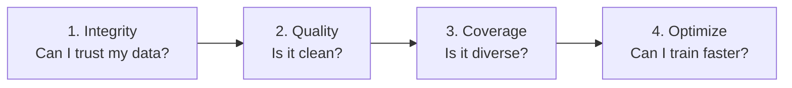

# Calibra

<p align="center">
  
</p>

**Stop wasting GPU hours on robot data that doesn't improve your policy.**

Calibra checks whether a robot dataset can be trusted, measures its quality and coverage, and builds quality-aware coresets, so you train on less data and know why before training begins.

```bash
pip install calibra-robotics
calibra integrity /data/my_demos.h5
calibra analyze   lerobot/pusht
calibra prune     lerobot/pusht --keep 0.25 --out coreset.json
```

---

## The workflow

Calibra is organized around the questions practitioners ask about a new dataset, in the order they ask them, not around a list of analyzers.



| Step | Question | Command | Docs |
|---|---|---|---|
| 1. Integrity | Can I trust this dataset? | `calibra integrity` | [Integrity Checks](integrity.md) |
| 2. Quality | Is it clean? | `calibra audit` / `calibra score` | [Command Reference](commands.md) |
| 3. Coverage | Is it diverse enough? | `calibra review` | [Command Reference](commands.md) |
| 4. Optimize | Can I train faster/cheaper? | `calibra prune` | [Command Reference](commands.md) |

`calibra analyze` runs all four steps in one report.

Integrity checks are deliberately the first thing Calibra runs: timestamp sync, episode completeness, and camera freeze/duplicate-frame detection catch the failures practitioners hit most often, before anything about quality or diversity matters. See [Integrity Checks](integrity.md) for the full list.

**New here?** [Using Calibra](guide.md) walks through all four steps end to end on one dataset, with annotated output and how to read each score.

---

## Why Calibra?

Robot learning labs collect thousands of demonstration episodes. Training on all of them blindly:

- ❌ **Trains on bad data without telling you.** Jerk spikes, dropped frames, communication lag and stuck actuators all look like valid training signal to a policy.
- ❌ **Spends compute on redundancy.** Large teleoperation datasets repeat the same motions many times, and GPU cost scales with volume, not uniqueness.
- ❌ **Leaves failures undiagnosable.** When a policy stalls or flails, you cannot tell whether the cause is the architecture, the training recipe or the data.

**On LeRobot PushT**, training a BC-MLP on 41 Calibra-selected episodes (25% of the 165 training episodes) gave a held-out action-prediction error 0.8% higher than training on all 165; a random 41 gave 2.2% higher. The selection kept 52% of the rare behaviors, against 34% for random. This is offline prediction error, not policy success rate. See [Benchmark results](benchmarks.md) for the full tables, other datasets and limitations.

All of this runs before any policy training, and the metrics come with bootstrap confidence intervals.

---

## Core commands

- `calibra integrity`: can I trust this dataset? Timestamps, sync, episode completeness, camera feed, jerky motion.
- `calibra audit`: full diagnostic report with bootstrap confidence intervals and per-episode outliers.
- `calibra review`: ranked episode review queue.
- `calibra prune`: quality filter plus diversity-aware coreset selection, or `--annotate` to keep every episode with a per-episode decision.
- `calibra analyze`: all of the above in one report, with a training-set recommendation.

Other commands (`compare`, `certify`, `corrupt`, `retarget`, `predict`, `watch` and more) are listed in the [Command Reference](commands.md); they are not validated to the same standard as the core commands.

**Formats:** LeRobot v1/v2/v3 (Parquet), HuggingFace Hub IDs, HDF5 (Isaac Lab, Robomimic), RLDS/TF Datasets, MCAP/ROS2 bags.

**Evidence-backed:** findings link to the [Claims Registry](claims.md), where every claim states what would falsify it.
